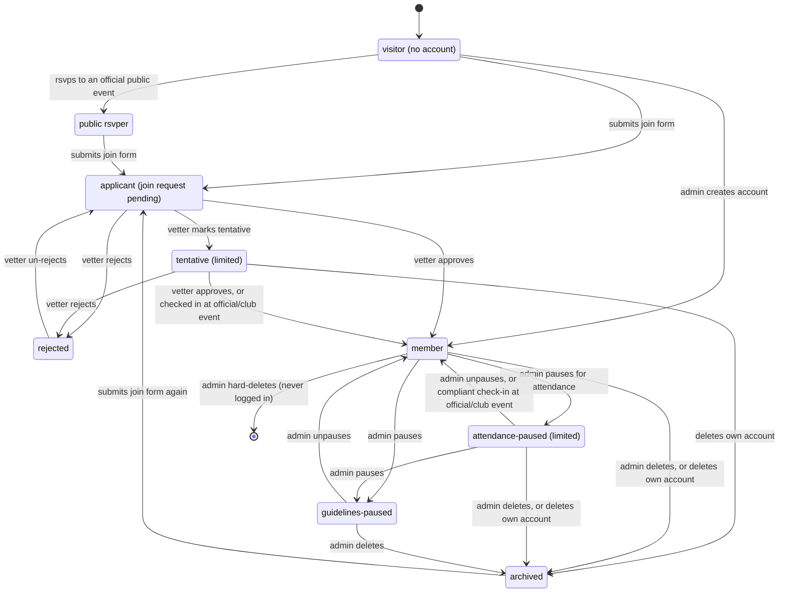
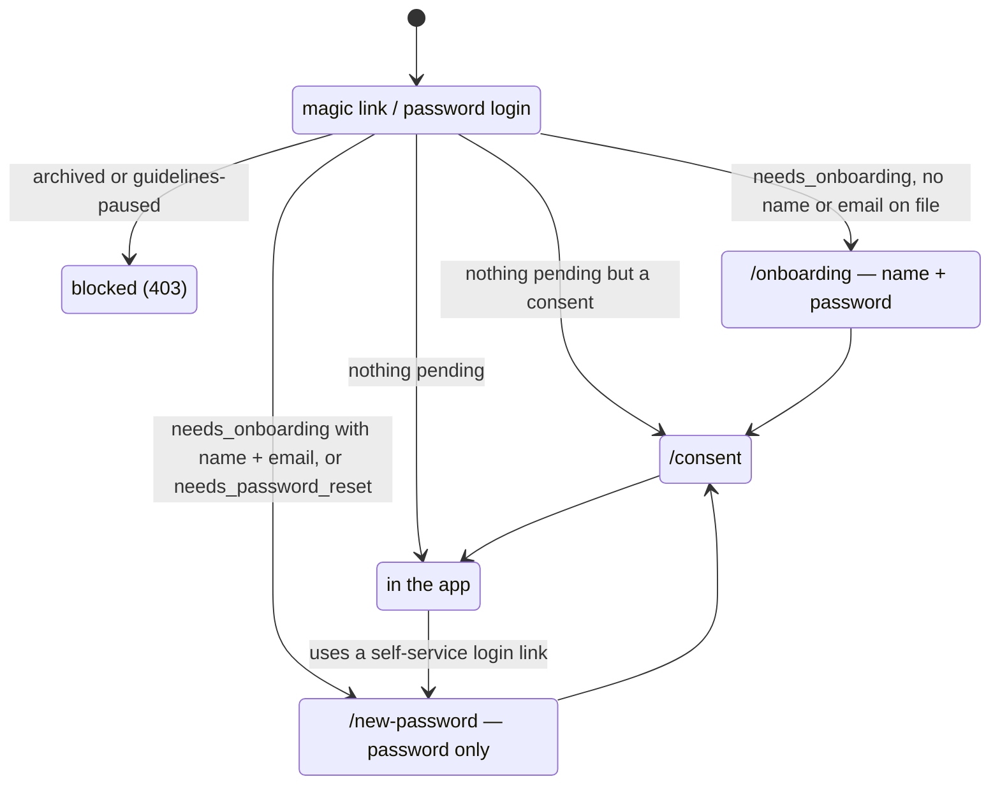

# User states

Every path a person can take through the app, from visitor to archived. What each type can do once there: [user-capabilities.md](user-capabilities.md). Update both when a transition or gate changes.

## Vocabulary

| Term | Means | Code |
|------|-------|------|
| non-member | `is_member=False` — every group below except member | `User.objects.members()` excludes them |
| public rsvper | RSVP'd without an account; can't sign in (unusable password) | `PublicRsvpToken` |
| limited | signed in but not a member: tentative or attendance-paused | `limited_q()`, `is_limited()` |
| tentative | limited because of a `TENTATIVE` join request | `JoinRequestStatus.TENTATIVE` |

## Lifecycle

### What each transition does

| Transition | Effect | Source |
|------------|--------|--------|
| rsvps to an official public event | creates `is_member=False` user with unusable password; issues or extends a 90-day `/my-rsvps` token (180-day cap) | `community/rsvps/public_submit.py` |
| submits join form | creates `JoinRequest` (pending), linked to an existing non-member by phone; no user row for a new visitor | `community/join_requests/submit.py` |
| vetter marks tentative | creates the user if needed, sets `needs_onboarding`, mints a magic link; stays `is_member=False` | `provision_tentative_user` |
| vetter approves | new user → create with member role; public rsvper → promote in place; tentative → promote in place, no new link; archived → clear `archived_at`, re-flag onboarding. All but tentative mint a magic link. `grant_membership` revokes rsvp tokens | `provision_approved_user` |
| checked in at official/club event | someone else checks a tentative user in → promoted, join request approved via that event | `maybe_promote_tentative` |
| vetter rejects | join request rejected + email; a tentative user's row is left as-is (`is_member=False`) | `join_requests/manage.py` |
| vetter un-rejects | back to pending, unless the phone already has an open request | `join_requests/unreject.py` |
| admin creates account | member with member role + magic link | `users/_management.py` `create_user` |
| admin pauses for attendance | `is_member=False`, all roles cleared, non-official/club RSVPs released, co-host spots dropped, solo-hosted events moved to draft | `apply_attendance_pause` |
| admin unpauses (attendance) | `is_member=True`, member role back; no restore stamp | `users/_attendance_pause.py` `_unpause` |
| compliant check-in | someone else checks them in at official/club and their attendance stats are compliant → restored, `restored_at` stamped, email | `check_in_promotion.py` |
| admin pauses (guidelines) | `is_paused=True`; elevated roles stripped, member role kept. Can't pause self or an admin | `users/_management.py` `update_user` |
| admin unpauses (guidelines) | `is_paused=False`, `unpaused_at` stamped, `has_joined_whatsapp` cleared, email. Returns to whatever the attendance flag says | `users/_unpause.py` |
| deletes / admin deletes | soft archive: `archived_at` set, calendar token cleared, elevated roles stripped, upcoming RSVPs released, co-host spots dropped | `users/_archive.py` |
| hard-deletes | row deleted; only when `last_login` is null and nothing protected references it | `users/_user_deletion.py` |

`is_paused` (guidelines) and `attendance_paused_at` are independent flags — a user can hold both. The diagram shows guidelines-paused as one state because it overrides everything else while set.

## Getting in

Approval, tentative, and admin-create all hand the person a 7-day magic link. After that, the same gates apply to everyone who can sign in, in this order (`config/auth.py` `account_block_code`):

Frontend routing for these gates lives in `frontend/src/auth/guards.tsx` (`OnboardingGate`) and `passwordSetupRedirect` / `consentRedirect` in `frontend/src/models/user.ts`.

## What each state can do

See [user-capabilities.md](user-capabilities.md).

## Open questions

- A tentative user who is then rejected keeps their account and password. Login only blocks archived and guidelines-paused users, so if they'd already finished onboarding they can still sign in as limited ([#2245](https://github.com/ProteinDeficientsAnonymous/pda/issues/2245)).
- An archived member who tries to sign in is told the account is no longer active, with no prompt to request to join again ([#2244](https://github.com/ProteinDeficientsAnonymous/pda/issues/2244)).
