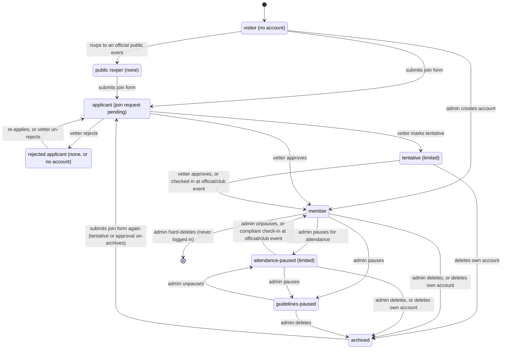
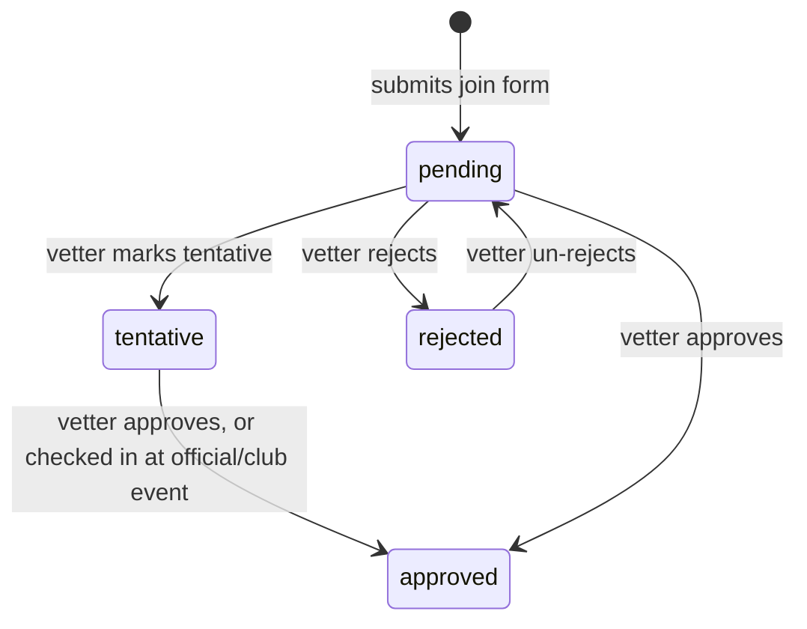
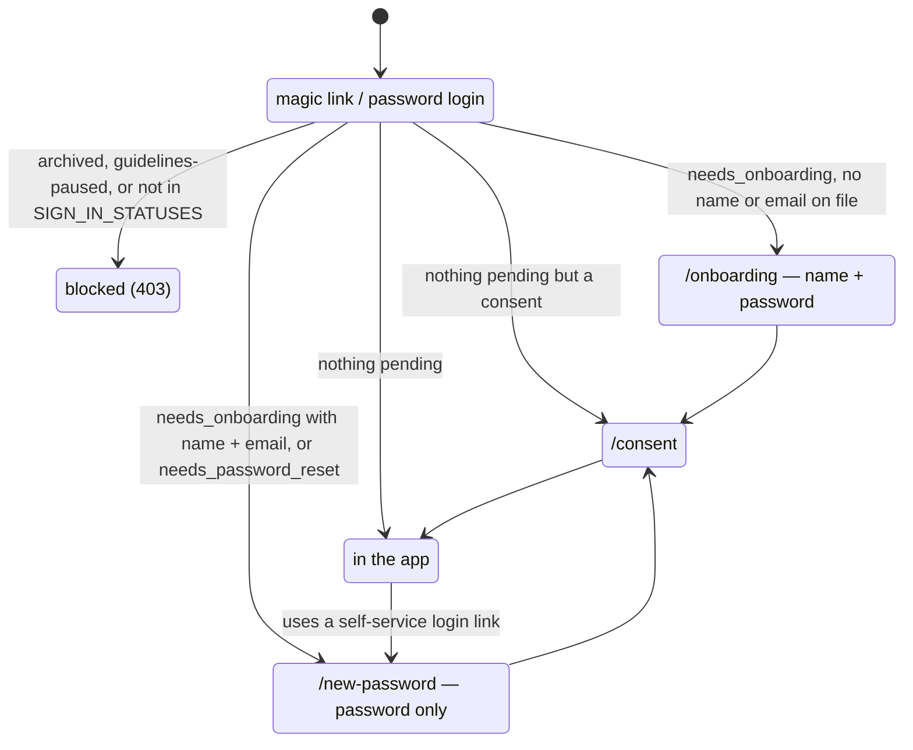

# User states

Every path a person can take through the app, from visitor to archived. What each type can do once there: [user-capabilities.md](user-capabilities.md). Update both when a transition or gate changes.

## Vocabulary

| Term | Means | Code |
|------|-------|------|
| member | `membership_status` in `MEMBER_STATUSES`: active, guidelines-paused or attendance-paused | `is_member` property, `User.objects.members()` |
| non-member | `none`, `tentative` or `archived` | `User.objects.members()` excludes them |
| `none` | base status for an account with no membership: a public rsvper, or a rejected or withdrawn applicant. Can't sign in | `MembershipStatus.NONE` |
| public rsvper | RSVP'd without an account; status `none`, unusable password | `PublicRsvpToken` |
| limited | signed in without full access: tentative, or attendance-paused (who still hold membership and the member role) | `limited_q()`, `is_limited()` |
| tentative | limited because of a `TENTATIVE` join request | `JoinRequestStatus.TENTATIVE` |

There is no `rejected` membership status. Rejection lives only on the join request.

## Lifecycle

### What each transition does

| Transition | Effect | Source |
|------------|--------|--------|
| rsvps to an official public event | creates a `none` user with unusable password; issues or extends a 90-day `/my-rsvps` token (180-day cap) | `community/rsvps/public_submit.py` |
| submits join form | creates `JoinRequest` (pending), linked to an existing non-member by phone; no user row for a new visitor | `community/join_requests/submit.py` |
| vetter marks tentative | creates the user if needed, sets `needs_onboarding`, mints a magic link; status `tentative`. An archived account matched by phone is un-archived: `archived_at`/`archived_by` cleared and every role dropped, or back to the pause it was archived under | `provision_tentative_user` |
| vetter approves | new user → create with member role; public rsvper → promote in place; tentative → promote in place, no new link; archived → clear `archived_at`/`archived_by`, re-flag onboarding, back to `active_member` (or a pause it was archived under). All but tentative mint a magic link. `grant_membership` revokes rsvp tokens | `provision_approved_user` |
| checked in at official/club event | someone else checks a tentative user in → promoted, join request approved via that event; skipped while guidelines-paused | `maybe_promote_tentative` |
| vetter rejects | pending join request rejected + email; the user row is untouched. They can't sign in (`auth.account_rejected`) or public-RSVP until they re-apply. A tentative request can't be rejected (400 `tentative_cannot_be_rejected`); archive or guidelines-pause them instead | `join_requests/manage.py` |
| vetter un-rejects | back to pending, unless the phone already has an open request | `join_requests/unreject.py` |
| admin creates account | member with member role + magic link | `users/_management.py` `create_user` |
| admin pauses for attendance | `attendance_paused`, elevated roles stripped (member role kept), non-official/club RSVPs released, co-host spots dropped, solo-hosted events moved to draft | `apply_attendance_pause` |
| admin unpauses (attendance) | `active_member`; re-grants the member role if missing; no restore stamp | `users/_attendance_pause.py` `_unpause` |
| compliant check-in | someone else checks them in at official/club and their attendance stats are compliant → restored, `restored_at` stamped, email | `check_in_promotion.py` |
| admin pauses (guidelines) | `guidelines_paused` (`is_paused` kept in sync); every upcoming RSVP released (official/club included), co-host spots dropped, solo-hosted events drafted, pending co-host invites rescinded, elevated roles stripped (member role kept), all audited. Can't pause self or an admin | `users/_management.py` `update_user`, `release_held_events` |
| admin unpauses (guidelines) | `attendance_paused`, `attendance_paused_at` set to now, `has_joined_whatsapp` cleared, member role kept. No `unpaused_at` stamp or email while a pause remains; a compliant check-in restores them | `User.set_guidelines_pause` |
| deletes / admin deletes | soft archive: `archived`, `archived_at` and `archived_by` set, calendar token cleared, elevated roles stripped, upcoming RSVPs released, co-host spots dropped | `users/_archive.py` |
| hard-deletes | row deleted; only when `last_login` is null and nothing protected references it | `users/_user_deletion.py` |

`membership_status` is the source of truth; `is_member` is a property, true for `MEMBER_STATUSES` (active, guidelines-paused, attendance-paused). Attendance-paused users hold membership and the member role but get limited access. The two pauses are mutually exclusive: a guidelines pause replaces an attendance pause, an attendance pause is refused while guidelines-paused, and lifting a guidelines pause leaves them attendance-paused until a compliant check-in restores them.

## Join requests

A join request has its own status, separate from the person's `membership_status`. `status_changed_at`/`status_changed_by` record the last move.

`tentative → rejected` is refused (400 `tentative_cannot_be_rejected`); archive or guidelines-pause them instead. One open (pending or tentative) request per phone. A rejected applicant re-applies with a new request, and the vetter card shows the earlier rejection and any archive.

## Getting in

Approval, tentative, and admin-create all hand the person a 7-day magic link. After that, the same gates apply to everyone who can sign in, in this order (`config/auth.py` `account_block_code`):

A status outside `SIGN_IN_STATUSES` (`none`) is blocked with `auth.account_rejected` when the phone's latest join request was rejected (the magic-login screen offers "request to join again"), and `auth.not_a_member` otherwise. MCP OAuth refuses them the same way, and a self-service login link request gets the neutral "an admin will follow up" reply instead of a link.

Frontend routing for these gates lives in `frontend/src/auth/guards.tsx` (`OnboardingGate`) and `passwordSetupRedirect` / `consentRedirect` in `frontend/src/models/user.ts`.

## What each state can do

See [user-capabilities.md](user-capabilities.md).

## Open questions

- An archived member who tries to sign in is told the account is no longer active, with no prompt to request to join again ([#2244](https://github.com/ProteinDeficientsAnonymous/pda/issues/2244)).
